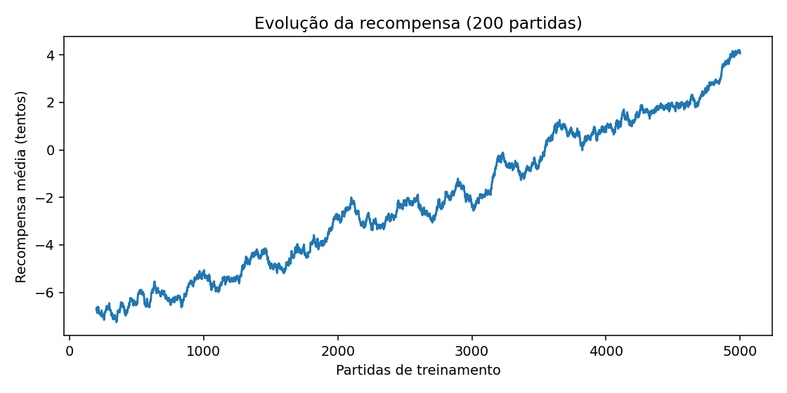

# Agente de Truco Mineiro com Aprendizado por Reforço

Alunos: Matheus Cruz e Tarik

Um agente que joga Truco Mineiro 2 contra 2, com baralho vazio. O agente controla um jogador; o parceiro e os adversários são bots com regras fixas.

## Desafio 1 — Definição do problema

Apresentação: [DESAFIO-1/Agente-Truco.pdf](DESAFIO-1/Agente-Truco.pdf)

- **Estado:** cartas na mão, cartas jogadas, resultados das rodadas, maior carta na mesa, valor da mão e placar.
- **Ações:** nove estratégias: matar barato, matar forte, deixar fazer, esconder, abrir forte, abrir fraco, trucar, aceitar e correr.
- **Recompensa:** tentos ganhos menos tentos perdidos pela dupla ao fim de cada mão.

## Desafio 2 — DQN

Código e detalhes: [DESAFIO-2/README.md](DESAFIO-2/README.md)

Foi treinada do zero uma rede DQN com máscara de ações, usando **5.000 partidas** (seed 42). Na avaliação final, sem exploração, o agente venceu **79,4% de 2.000 partidas** contra os bots do ambiente.



[Ver gráfico da taxa de vitórias](DESAFIO-2/resultados/treino_final/grafico_vitorias.png)

## Como rodar

Na raiz do repositório:

```bash
python -m pip install -r DESAFIO-2/requirements.txt
python -m pytest -q DESAFIO-2/testes
python DESAFIO-2/src/ver_jogo.py
python DESAFIO-2/src/treinar.py --rapido --saida DESAFIO-2/resultados/teste_rapido
```
